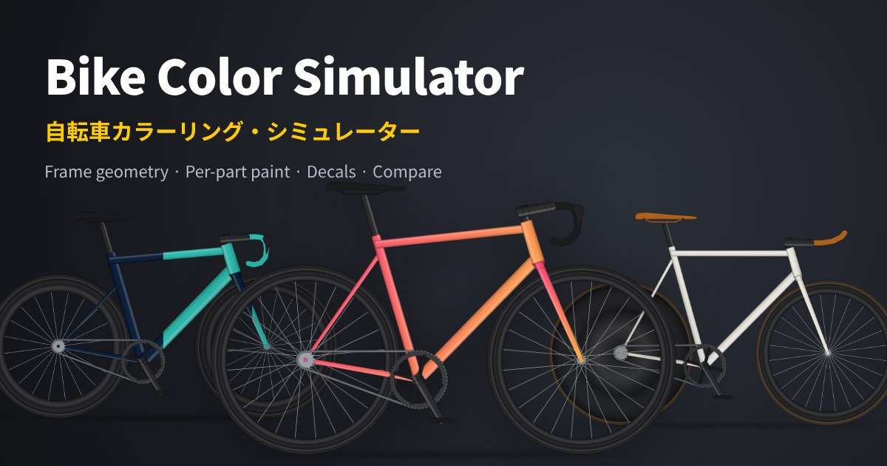
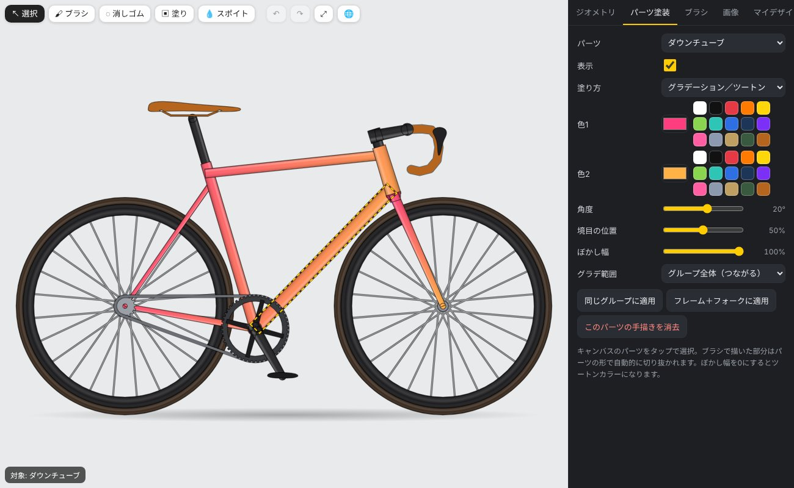
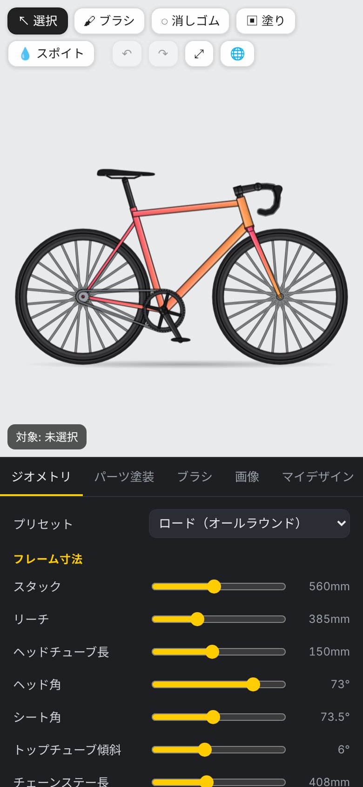

# Bike Color Simulator｜自転車カラーリング・シミュレーター

**▶ アプリを開く / Open the app: https://shizimikai.github.io/Bicycle-color-simulator/**

ブラウザだけで動く、自転車のカラーリングシミュレーターです。フレーム形状やホイールを調整して、パーツごとに色を塗ったり、手描きしたり、ロゴ画像を貼ったりできます。インストール不要で、スマホでもPCでも使えます。

*English below.*

  
  

## できること

- **ジオメトリ調整**：ロード／エアロ／ピスト／グラベル／MTB／ミニベロ／キッズ（16インチ）のプリセット。スタック、リーチ、ヘッド角、シート角、トップチューブ傾斜、チェーンステー長、BBドロップなどをmm単位で調整
- **パーツ形状**：チューブの太さ、ホイール径（700C〜16"）、リムハイト、タイヤ幅、スポーク本数・組み方、ディスクホイール、ハンドル形状、サスペンションフォーク
- **パーツごとの塗装**：約30パーツを単色・グラデーション・ツートンで塗り分け。フレーム全体でつながるフェードや、チューブの向きに沿うフェードも可能。よく使う色は「マイカラー」に保存
- **お絵かき**：ブラシ（太さ・不透明度・硬さ）、消しゴム、スポイト。描いた部分はパーツの形で自動的に切り抜き
- **画像の貼り付け**：透過PNGを移動・拡大縮小・回転・反転して配置。パーツに貼り付けるとその形で切り抜き（デカールに便利）。画像の上にも描画可能
- **保存と比較**：ブラウザ内に複数のデザインを保存し、最大3つを並べて比較。PNG書き出し（透過背景対応）、プロジェクトファイル（.json）の保存・読込
- **日本語／英語**：ブラウザの言語で自動切替（🌐ボタンで変更可）

## 使い方のコツ

- パーツをタップして選択 →「パーツ塗装」タブで色を設定
- 2本指でズーム・移動。何もない所のドラッグでも移動できます
- 「ぼかし幅」を0にするとツートンカラーになります

## 技術メモ

`index.html` 1ファイルで完結（外部ライブラリなし、Canvas 2D）。データはブラウザ内（IndexedDB）に保存され、サーバーには送信されません。

---

## English

A bicycle paint-job simulator that runs entirely in your browser — no install, works on phones and desktops.

- **Geometry**: presets for road, aero, track, gravel, MTB, mini velo and a 16" kids bike; adjust stack, reach, head/seat angles, top tube slope, chainstay length, BB drop and more (in mm)
- **Parts**: tube sizes, wheel size (700C–16"), rim depth, tire width, spoke count and lacing, disc wheels, handlebar type, suspension fork
- **Per-part paint**: ~30 parts, solid / gradient / two-tone, with fades that flow across the whole frame or follow each tube; save favorite colors to “My colors”
- **Freehand painting**: brush, eraser and eyedropper, automatically clipped to the part shape
- **Decals**: place transparent PNGs, move/scale/rotate/flip them, clip them to a part, and paint on them
- **Save & compare**: keep multiple designs in the browser and compare up to 3 side by side; export PNG (transparent background optional) or save/load a .json project
- **Japanese / English** UI, chosen automatically from your browser language

Everything lives in a single `index.html` (no dependencies). Your data stays in your browser.
